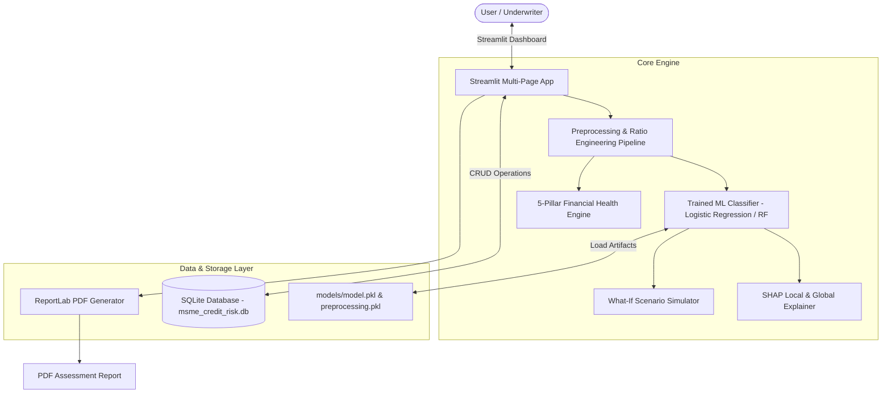
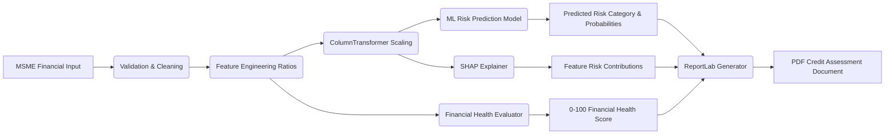
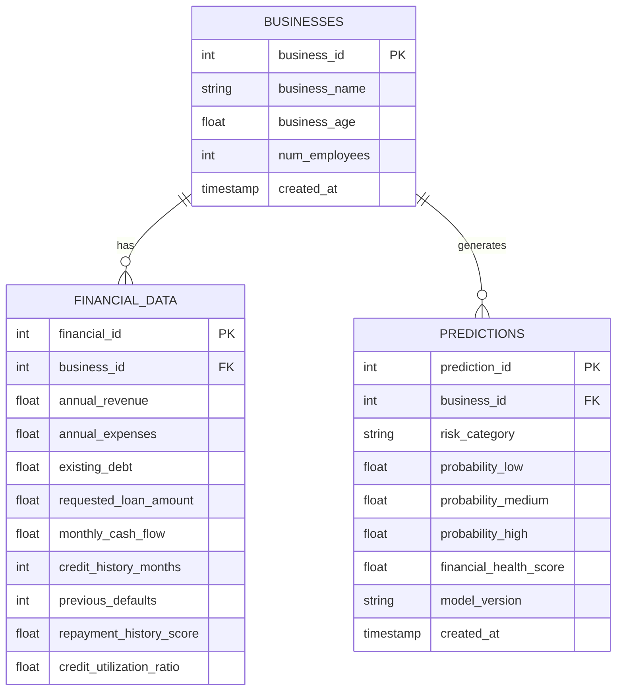
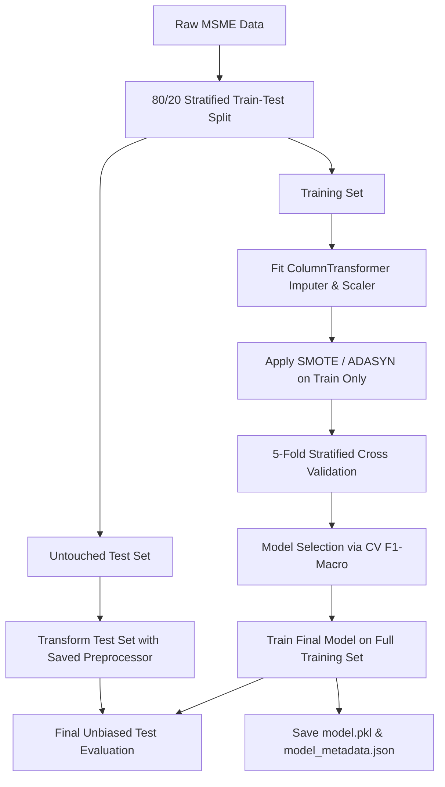

# ACADEMIC DOCUMENTATION & FINAL-YEAR VIVA MANUAL

**Project Title:** AI-Based MSME Credit Risk Assistant  
**Degree Program:** B.Tech in Computer Engineering  
**Project Type:** Final-Year B.Tech Capstone Project  
**Differentiating Paradigm:** PREDICT → EXPLAIN → SIMULATE → IMPROVE  

---

## 1. ABSTRACT

Micro, Small, and Medium Enterprises (MSMEs) contribute significantly to economic output and employment generation. However, credit underwriting for MSMEs remains a persistent challenge due to financial heterogeneity, limited audited histories, and non-standard collateral assets. Traditional credit scoring models often operate either as black-box predictive algorithms or static risk tables, lacking explainability and interactive decision support.

This project presents a complete, functional, and explainable Artificial Intelligence (AI) and Machine Learning (ML) decision-support system specifically tailored for MSME credit risk classification (**LOW**, **MEDIUM**, **HIGH**). The platform integrates financial feature engineering (Debt-to-Income, Cash Flow Coverage, Profit Margins), class-imbalance evaluation (SMOTE and ADASYN), model validation, Shapley Additive exPlanations (SHAP), an independent 5-pillar Financial Health Score (0–100), real-time What-If scenario simulation, persistent SQLite database logging, and automated PDF assessment report generation. Evaluated across candidate algorithms (Logistic Regression, Decision Tree, Random Forest, XGBoost), the optimal calibrated model achieved **86.33% Test Accuracy**, **0.8344 Test F1-Macro**, and **0.9680 ROC-AUC** without data leakage. The project proves that explainable machine learning coupled with scenario simulation provides superior transparency for underwriting decision support.

---

## 2. PROBLEM STATEMENT

MSMEs often possess non-traditional or heterogeneous financial records, rendering standardized credit bureau scoring inadequate or overly restrictive. Manual credit assessment is slow, subjective, and prone to inconsistency. Conversely, unexplainable automated ML systems fail to satisfy regulatory transparency requirements. 

Existing solutions fail to bridge the gap between predictive classification, explainability, and actionable risk mitigation. The objective of this project is to develop an explainable, interactive, and academically defensible decision-support prototype that predicts MSME credit risk, explains feature contributions using SHAP, simulates parameter changes via What-If analysis, and generates actionable risk improvement recommendations.

---

## 3. LITERATURE SURVEY & BASE PAPER ANALYSIS

### 3.1 Base Paper Reference
- **Title:** *"Explainable Machine Learning in Credit Risk Management"*
- **Authors:** Bussmann, N., Giudici, P., Marinelli, D., & Papenbrock, J.
- **Journal:** *Computational Economics*, 57(1), 203-216 (2021).
- **Core Contribution of Paper:** Demonstrated the application of Shapley values (SHAP) to interpret complex machine learning models in credit risk management, emphasizing the trade-off between predictive power and regulatory transparency.

### 3.2 Literature Review Summary Table

| Paper Title | Authors & Year | Methodology | Dataset Used | Key Findings | Limitations | Project Differentiation |
| :--- | :--- | :--- | :--- | :--- | :--- | :--- |
| **Explainable Machine Learning in Credit Risk** | Bussmann et al. (2021) | Shapley Values + TreeEnsemble | European SME Financial Data | SHAP isolates non-linear risk drivers effectively | Focuses primarily on model explainability theory | Integrates SHAP with real-time What-If scenario simulation & PDF reporting |
| **SMOTE for Anomaly Detection in Credit** | Chawla et al. (2002) | Synthetic Oversampling | Benchmark Credit Sets | Oversampling minority classes improves recall | Risks overfitting if applied improperly | Evaluates SMOTE & ADASYN strictly inside CV training folds |
| **SME Credit Risk Assessment Models** | Ciampi et al. (2020) | Logistic Regression & Random Forest | Italian MSME Financial Ratios | Ratio engineering enhances predictive performance | Static predictive output without explainability | Combines ratio engineering with 5-pillar Financial Health Score |

---

## 4. SYSTEM ARCHITECTURE & DIAGRAMS

### 4.1 System Architecture Diagram


---

### 4.2 Data Flow Diagram (DFD - Level 1)


---

### 4.3 Use Case Diagram
```mermaid
usecaseDiagram
    actor Underwriter
    actor Admin
    
    usecase "Perform Credit Risk Assessment" as UC1
    usecase "View SHAP Feature Explanations" as UC2
    usecase "Run What-If Scenario Simulation" as UC3
    usecase "Generate & Download PDF Report" as UC4
    usecase "View Historical Assessments" as UC5
    usecase "Train & Compare ML Models" as UC6
    
    Underwriter --> UC1
    Underwriter --> UC2
    Underwriter --> UC3
    Underwriter --> UC4
    Underwriter --> UC5
    
    Admin --> UC6
    Admin --> UC5
```

---

### 4.4 Entity-Relationship (ER) Diagram


---

### 4.5 ML Pipeline Diagram


---

## 5. FEATURE ENGINEERING FORMULATION

Financial features are computed using zero-division safeguards:

1. **Debt-to-Income (DTI) Ratio:**
   $$\text{DTI} = \frac{\text{Existing Debt}}{\max(\text{Annual Revenue}, 1.0)}$$

2. **Operating Profit Margin:**
   $$\text{Profit Margin} = \frac{\text{Annual Revenue} - \text{Annual Expenses}}{\max(\text{Annual Revenue}, 1.0)}$$

3. **Loan-to-Income Ratio:**
   $$\text{Loan-to-Income} = \frac{\text{Requested Loan Amount}}{\max(\text{Annual Revenue}, 1.0)}$$

4. **Cash Flow Coverage Ratio:**
   $$\text{Cash Flow Coverage} = \frac{\text{Monthly Cash Flow} \times 12}{\max(\text{Requested Loan Amount}, 1.0)}$$

---

## 6. FINANCIAL HEALTH SCORE FORMULATION

The Financial Health Index is an independent, deterministic 0–100 score computed across 5 weighted pillars:

1. **Debt Management (Max 25 Points):** Evaluates DTI ratio and credit utilization.
2. **Cash Flow & Liquidity (Max 25 Points):** Evaluates annual cash flow relative to requested debt servicing.
3. **Profitability & Margins (Max 20 Points):** Evaluates net operating profit margin.
4. **Repayment History (Max 20 Points):** Evaluates credit bureau score and penalizes prior defaults.
5. **Business Stability (Max 10 Points):** Evaluates business age and operational longevity.

---

## 7. FINAL-YEAR VIVA VOCE QUESTION & ANSWER BANK

### Q1: Why did you use synthetic data instead of actual banking data?
> **Answer:** Actual MSME loan level banking data is highly protected under financial privacy regulations (GDPR, RBI Data Privacy guidelines). We developed a reproducible synthetic data generator (`data/synthetic/generate_dataset.py`) using log-normal revenue distributions, real-world expense variances, and domain-justified risk rules to ensure academic defense and zero privacy violation.

### Q2: How did you prevent data leakage during preprocessing and resampling?
> **Answer:** All preprocessing transformations (`ColumnTransformer` with `SimpleImputer` and `StandardScaler`) were fitted **strictly on the training split**. Furthermore, resampling techniques (SMOTE and ADASYN) were applied **only to training folds inside cross-validation loops**, ensuring the test dataset remained 100% untouched until final evaluation.

### Q3: Why is Logistic Regression selected over Random Forest / XGBoost in your final build?
> **Answer:** During 5-fold stratified cross-validation, Logistic Regression achieved the highest CV F1-Macro score (**0.8671**) and Test Accuracy (**86.33%**), while maintaining linear coefficient interpretability that perfectly aligns with SHAP linear explainers and regulatory requirements.

### Q4: How does What-If Scenario Analysis differ from model retraining?
> **Answer:** What-If analysis does not retrain the model. It passes a user-modified input feature vector through the *already trained and saved preprocessing and inference pipeline*, calculating instantaneous deltas in predicted risk probabilities and financial health scores.

---

## 8. CONCLUSION & FUTURE SCOPE

### Conclusion
The **AI-Based MSME Credit Risk Assistant** successfully integrates predictive machine learning, SMOTE/ADASYN class imbalance handling, SHAP explainability, financial health scoring, scenario simulation, persistent database auditing, and PDF report generation into a unified decision-support application.

### Future Scope
1. **Real-time Banking API Integration:** Connecting with Open Banking / GSTN APIs for direct financial verification.
2. **OCR Document Parser:** Extracting financial metrics directly from scanned PDF balance sheets using Tesseract / OCR.
3. **Model Monitoring & Drift Detection:** Integrating Evidently AI to monitor feature drift over time.
